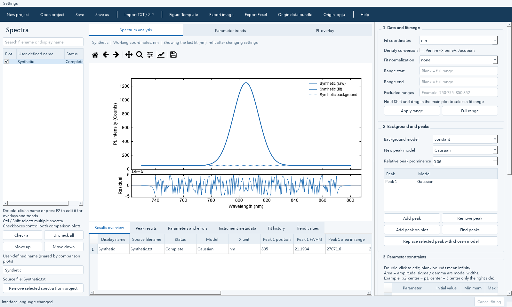

# LumiPeak — PL Studio

[繁體中文](README.md) | [English](README.en.md)

**Steady-state photoluminescence (PL) analysis for Windows, with peak fitting, spectral overlays, parameter trends and figure export.**

One application includes Traditional Chinese and English with immediate language switching. This repository hosts the PL Studio source, documentation and Windows releases.

[⬇ Download for Windows](https://github.com/weihaochiu/LumiPeak/releases/latest/download/PL-Studio-Setup.exe) · [User guide](docs/USER_GUIDE.en.md) · [Requirements and verification log](docs/需求紀錄.md) · [Report an issue](https://github.com/weihaochiu/LumiPeak/issues)

<!-- DOWNLOAD_STATUS -->
> **Latest stable release: [v0.5.0](https://github.com/weihaochiu/LumiPeak/releases/tag/v0.5.0)** · Windows x64 · Traditional Chinese / English.
> Download `PL-Studio-Setup.exe` using the button above. The installer includes Python and required libraries.
<!-- /DOWNLOAD_STATUS -->



*The screenshot uses a synthetic Gaussian spectrum and contains no private measurements.*

## Download and install

Installation steps:

1. Open [Releases](https://github.com/weihaochiu/LumiPeak/releases) and download `PL-Studio-Setup.exe`.
2. Run the installer and follow the wizard. A desktop shortcut is optional.
3. Launch **PL Studio** from the Start menu or desktop.

The installer includes Python and required libraries. No separate development tools are needed.

| Item | Details |
|---|---|
| System | Windows 10 version 1809 or later, or Windows 11; x64 |
| Languages | Traditional Chinese / English, switchable in the same application |
| Network | Used for downloads and update checks; analysis works offline |
| Origin | Direct `.opju` export requires compatible `originpro` and licensed Origin. Analysis, image and Excel export do not require Origin |

## Features

| Feature | Included capabilities |
|---|---|
| Import | TXT, CSV, DAT, TSV and ZIP; drag and drop, retained instrument metadata and custom names |
| Fitting | Gaussian, Lorentzian, Voigt, PseudoVoigt, SkewedGaussian and SkewedVoigt; constant, linear or no background |
| Constraints | Initial values, bounds, fixed parameters, lmfit expressions and joint fits with shared parameters |
| Batch analysis | Single, batch and joint fits, cancellation and fit history |
| Comparison plots | Raw / normalized PL overlays and Condition trends; dot, line, dot-line, bar and area plots |
| Figure Template | Plot dimensions, axes, ticks, lines, legends, insets, text and arrows |
| Export and save | PNG, JPEG, PDF, SVG, Excel, Origin data bundles, self-contained `.plproj` projects and recovery snapshots |

## Quick start

1. **Import** two-column wavelength (nm) / intensity text data with at least 10 valid numeric rows.
2. **Configure** the fitting coordinates, range, background, peak models, initial values and constraints.
3. **Fit** the current spectrum, or select several spectra for batch or joint fitting.
4. **Inspect** convergence, residuals, parameter errors and warnings.
5. **Compare and export** checked spectra as PL overlays or Condition trends. Adjust appearance in Figure Template, export results and save the project.

Left-hand checkboxes control plot content. Ctrl / Shift highlighting selects data for batch operations. See the [user guide](docs/USER_GUIDE.en.md) for detailed operations and definitions.

## Language and updates

- **Language:** `Settings → 語言 / Language → English / 繁體中文`. Changes apply immediately and are remembered. On first launch, Chinese Windows uses Traditional Chinese; other system languages use English.
- **Startup checks:** background checks look for newer stable GitHub Releases and offer Download update, Remind me later and Skip this version.
- **Manual checks:** use `Settings → Check for updates now`, or disable startup checks. Manual checks can show previously skipped versions.
- **Installing updates:** save your project and close PL Studio before running the downloaded installer.
- **Offline access and data:** failed checks do not interrupt analysis. Checks retrieve public version information without uploading spectra or project data.

## Analysis scope

- Each spectrum is managed separately. Spectra sharing a Condition remain separate points; no replicate averaging or group statistics are performed.
- Fits use unweighted least squares. Parameter standard errors are local covariance estimates.
- Counts are not calibrated photon counts. The optional Jacobian requires input defined as spectral density per nm.
- Peak decomposition alone does not establish physical assignments. A single uncalibrated PL spectrum does not determine lifetime, defect density, PLQY or QFLS.
- Origin exports currently transfer data and basic curves without reproducing all Figure Template styles.

See the [user guide](docs/USER_GUIDE.en.md) for area, peak-position, FWHM, mask and comparison definitions.

## Run from source

For development or modification, obtain and extract the complete source, install Python 3.11+ (3.12 recommended), then run these commands in the project root:

```powershell
python -m venv .venv
.\.venv\Scripts\python.exe -m pip install -r requirements.txt
.\.venv\Scripts\python.exe main.py
```

Alternatively run `INSTALL.bat`, then `START_PL.bat`. `START_DEMO.bat` generates and opens synthetic spectra when no local reference demo is available.

## Documentation and support

- [User guide](docs/USER_GUIDE.en.md): operations, figure settings, definitions and limitations.
- [Requirements and verification log](docs/需求紀錄.md): dated requirements, status and validation evidence, in Traditional Chinese.
- [Build and release guide](docs/RELEASING.md): maintainer packaging and publication steps.
- [Issues](https://github.com/weihaochiu/LumiPeak/issues): include application version, Windows version, reproduction steps and error messages. Synthetic examples without private data are welcome.

Local installation, installed-application and uninstall checks have passed, along with 56 existing feature tests and 14 release / language tests. GitHub Actions passed 68 tests; 2 tests requiring local reference data were skipped. Compatibility on another computer still requires validation. No source license has been selected yet.
