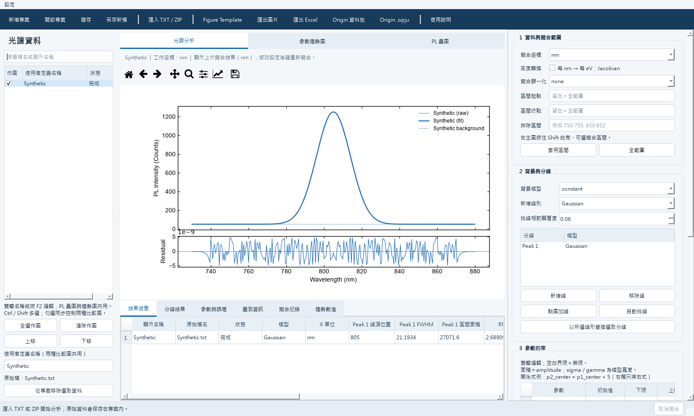

# LumiPeak — PL Studio

[繁體中文](README.md) | [English](README.en.md)

**Windows 穩態光致發光（PL）光譜分析軟體，提供分峰擬合、光譜疊圖、參數趨勢與圖形匯出。**

同一套軟體支援繁體中文與英文，可在設定選單即時切換。LumiPeak 是 PL Studio 的原始碼、說明文件與 Windows 發佈專案。

[⬇ 下載 Windows 安裝版](https://github.com/weihaochiu/LumiPeak/releases/latest/download/PL-Studio-Setup.exe) · [詳細使用說明](docs/USER_GUIDE.zh-TW.md) · [需求與驗證紀錄](docs/需求紀錄.md) · [問題回報](https://github.com/weihaochiu/LumiPeak/issues)

<!-- DOWNLOAD_STATUS -->
> **最新正式版：[v0.5.0](https://github.com/weihaochiu/LumiPeak/releases/tag/v0.5.0)** · Windows x64 · 繁體中文／English。
> 點上方按鈕下載 `PL-Studio-Setup.exe`。安裝包已包含 Python 與必要套件。
<!-- /DOWNLOAD_STATUS -->



*畫面使用合成 Gaussian 光譜示範，不包含私人量測資料。*

## 下載與安裝

安裝步驟：

1. 開啟 [Releases](https://github.com/weihaochiu/LumiPeak/releases)，下載 `PL-Studio-Setup.exe`。
2. 執行安裝檔，依精靈完成安裝；可選擇建立桌面捷徑。
3. 從開始功能表或桌面開啟 **PL Studio**。

安裝版包含 Python 與必要套件，使用者無需另外安裝開發工具。

| 項目 | 說明 |
|---|---|
| 系統 | Windows 10 1809 或以上、Windows 11；x64 |
| 語言 | 繁體中文／English，同一套程式內切換 |
| 網路 | 下載與檢查更新時使用；光譜分析可離線執行 |
| Origin | 直接匯出 `.opju` 時另需相容的 `originpro` 與已授權 Origin；一般分析、圖片及 Excel 匯出不需要 Origin |

## 主要功能

| 功能 | 提供內容 |
|---|---|
| 資料匯入 | TXT、CSV、DAT、TSV 與 ZIP；支援拖曳、儀器資訊保留、自訂名稱 |
| 光譜擬合 | Gaussian、Lorentzian、Voigt、PseudoVoigt、SkewedGaussian、SkewedVoigt；常數、線性或無背景 |
| 參數約束 | 初始值、上下限、固定參數、lmfit 關係式、共用參數聯合擬合 |
| 批次分析 | 目前光譜、批次擬合、聯合擬合、取消執行與擬合歷史 |
| 比較圖形 | 原始強度／Normalized PL 疊圖、Condition 參數趨勢；Dot、Line、Dot-Line、Bar、Area |
| Figure Template | 獨立設定尺寸、座標軸、刻度、線條、圖例、Inset、文字與箭頭 |
| 匯出與保存 | PNG、JPG、PDF、SVG、Excel、Origin 資料包；完整 `.plproj` 專案與自動復原檔 |

## 快速開始

1. **匯入資料**：使用波長 nm、強度兩欄的文字檔，至少 10 列有效數值。
2. **設定模型**：選擇擬合座標、範圍、背景與峰形，檢查初始值及約束。
3. **執行擬合**：處理目前光譜，或選取多條資料進行批次／聯合擬合。
4. **檢查結果**：查看收斂狀態、殘差、參數誤差與警示。
5. **比較與匯出**：勾選資料製作 PL 疊圖或 Condition 趨勢，透過 Figure Template 調整版面，再匯出並儲存專案。

左側「勾選」控制作圖內容；Ctrl／Shift 的「反白選取」控制批次操作。更多操作、參數定義與格式設定請見 [詳細使用說明](docs/USER_GUIDE.zh-TW.md)。

## 語言切換與版本更新

- **切換語言**：`設定 → 語言 / Language → 繁體中文 / English`，立即生效並記住選擇。首次啟動時，中文 Windows 使用繁體中文，其餘語言使用英文。
- **啟動檢查**：預設在背景檢查 GitHub 最新正式 Release；發現新版時提供「下載更新」「稍後提醒」「略過此版本」。
- **手動檢查**：使用 `設定 → 立即檢查更新`，也可關閉「啟動時檢查更新」。手動檢查可顯示先前略過的版本。
- **更新安裝**：下載新版安裝檔後，先儲存專案並關閉 PL Studio，再執行安裝。
- **離線與資料**：檢查失敗不影響分析；版本檢查只讀取公開版本資訊，不上傳光譜或專案資料。

## 分析結果的使用範圍

- 每條光譜獨立管理；相同 Condition 的資料仍各為一點，不做重複量測平均或分組統計。
- 預設為未加權最小平方法；參數標準誤來自局部協方差估計。
- Counts 不等於已校正光子數；Jacobian 僅適用於已定義為每 nm 光譜密度的輸入。
- 峰形分解本身不確定物理歸屬；單條未校正 PL 不會給出壽命、缺陷密度、PLQY 或 QFLS。
- Origin 匯出目前提供資料與基本曲線，未完整轉換 Figure Template 樣式。

詳細的面積、峰頂位置、FWHM、遮罩及跨光譜比較定義請見 [使用說明](docs/USER_GUIDE.zh-TW.md)。

## 從原始碼執行

適用於開發或修改程式。取得並解壓縮完整原始碼後，安裝 Python 3.11 或以上（建議 3.12），在專案根目錄執行：

```powershell
python -m venv .venv
.\.venv\Scripts\python.exe -m pip install -r requirements.txt
.\.venv\Scripts\python.exe main.py
```

也可使用 `INSTALL.bat` 安裝依賴，再以 `START_PL.bat` 啟動。`START_DEMO.bat` 可產生並開啟合成光譜示範；本機若已有參考示範專案，會優先開啟。

## 文件與問題回報

- [詳細使用說明](docs/USER_GUIDE.zh-TW.md)：操作、圖形設定、結果定義與限制。
- [需求與驗證紀錄](docs/需求紀錄.md)：日期、需求、完成狀態及測試依據。
- [建置與發佈說明](docs/RELEASING.md)：維護者的打包及發佈流程。
- [Issues](https://github.com/weihaochiu/LumiPeak/issues)：請提供版本、Windows 版本、操作步驟與錯誤訊息。可附去除私人內容的合成重現資料。

本機已完成安裝、安裝後執行、解除安裝，以及原有 56 項功能與新增 14 項發佈／雙語測試；GitHub Actions 清潔環境另有 68 項通過、2 項需本機參考資料的測試略過；跨電腦相容性仍需驗證。原始碼授權條款尚未選定。
